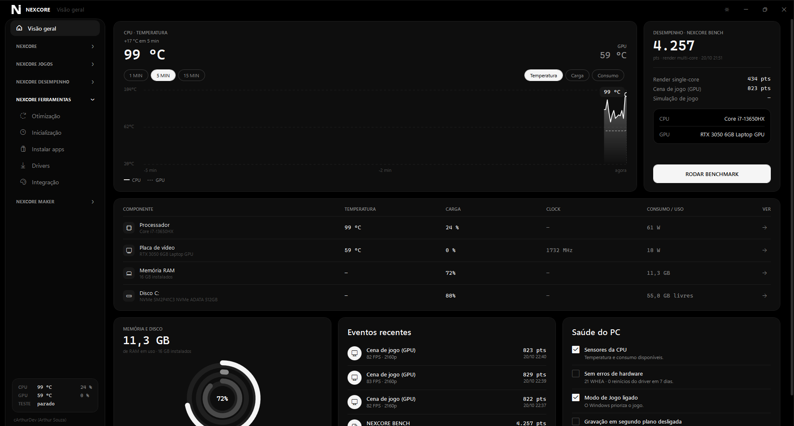
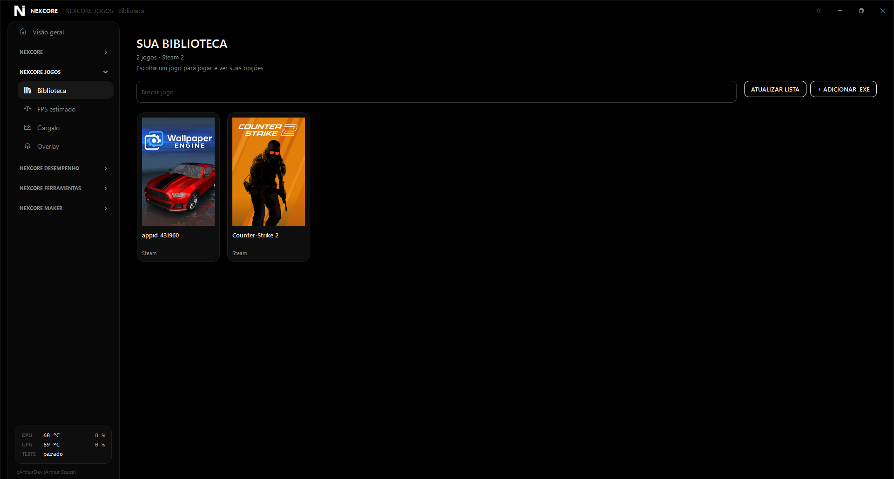
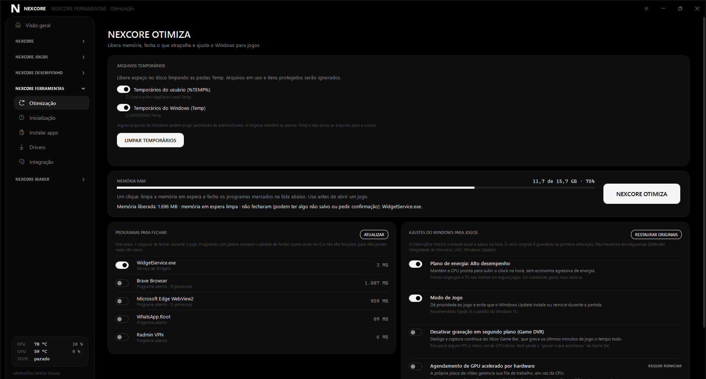

<div align="center">


### Diagnóstico, desempenho e controle do seu PC Windows

Informações detalhadas de hardware, sensores em tempo real, benchmarks,
stress tests, overlay de jogos e ferramentas para otimização em um só lugar.

[](NEXCORE.csproj)
[](#requisitos)
[](#desenvolvimento)
[](LICENSE)

[Baixar](#baixar) · [Recursos](#recursos) · [Como usar](#como-usar) · [Desenvolvimento](#desenvolvimento) · [Privacidade](#privacidade)

</div>

---

O NEXCORE é um aplicativo WPF para Windows criado por **cArthurDev (Arthur
Souza)**.
Ele combina diagnóstico de hardware, testes reproduzíveis e ferramentas
práticas para jogos, manutenção e criação com Arduino.

> **Em resumo:** descubra o que há no seu PC, acompanhe o que ele está fazendo,
> encontre gargalos e compare o desempenho sem instalar várias ferramentas
> diferentes.

## Capturas de tela

<div align="center">

| Página inicial | Biblioteca de jogos |
|:---:|:---:|
|  |  |

| Otimização |
|:---:|
|  |

</div>

## Baixar

### Usuários

Não é necessário baixar o código-fonte nem instalar o .NET. Depois que o novo
repositório for criado, publique o executável portátil na área de Releases e
adicione aqui os links diretos para o `.exe` e o `.zip`.

O `.exe` será uma versão portátil independente para Windows x64. O `.zip`
deverá incluir o executável, `LEIA-ME.txt` e `LICENSE`. O pacote de instalação
também poderá criar atalhos no menu Iniciar e na área de trabalho.

Após baixar:

1. Extraia o `.zip` ou execute o instalador.
2. Abra `NEXCORE.exe`.
3. Se o Windows exibir o SmartScreen, clique em **Mais informações** e depois
   em **Executar assim mesmo**. O executável ainda não possui assinatura
   Authenticode.
4. Para leituras de temperatura e consumo da CPU, instale o [PawnIO](https://github.com/namazso/PawnIO):

   ```powershell
   winget install namazso.PawnIO
   ```

   O próprio aplicativo também oferece o botão **CORRIGIR** quando essa
   dependência é necessária. Depois da instalação, feche e abra o NEXCORE.

### Requisitos

- Windows 10 ou 11, 64 bits.
- GPU compatível com Direct3D 11 para o stress test e o benchmark de cena.
- DirectX 12 e suporte a DXR 1.1 para o benchmark de ray tracing.
- Permissão de administrador apenas para recursos que precisam acessar
  sensores, dispositivos, drivers ou configurações protegidas.
- Internet somente para recursos que dependem de serviços externos, como
  winget, dados de jogos, teste de rede e integração com fabricantes.

O suporte a sensores varia conforme a placa-mãe, o processador e o driver.
Algumas leituras podem não estar disponíveis em determinado hardware.

## Recursos

### Diagnóstico e monitoramento

- **Informações do sistema:** Windows, placa-mãe, BIOS, CPU, RAM por módulo,
  GPU, discos e unidades de rede/USB.
- **Sensores ao vivo:** temperatura, carga, clock, tensão, consumo e
  ventoinhas, atualizados a cada segundo.
- **GPU em estilo GPU-Z:** arquitetura, shaders, memória, clocks, PCIe, VBIOS,
  driver, CUDA, DirectX, NVENC/NVDEC, P-state e limitador de desempenho.
- **Saúde dos discos (S.M.A.R.T.):** temperatura, horas ligadas, desgaste de
  SSD, setores realocados, erros e previsão de falha quando o dispositivo
  fornece esses dados.
- **Rede:** latência, jitter, perda de pacotes, DNS, download, upload e
  bufferbloat, separando possíveis problemas locais de problemas do provedor.
- **Energia:** bateria, ciclos, desgaste, autonomia, plano de energia e
  consumo de CPU/GPU.
- **Relatórios:** exportação das informações do sistema, módulos de RAM,
  discos e saúde dos discos para HTML ou JSON.

### Jogos e desempenho

- **Detector de gargalo:** análise ao vivo e por sessão, identificando limites
  de GPU, CPU, VRAM, RAM, temperatura ou FPS e sugerindo ações.
- **Overlay:** FPS, frametime, 1% low, gráfico, GPU, VRAM, CPU, RAM, nome do
  jogo e hora. Atalho global **Ctrl+Shift+O**. Funciona em jogos de janela sem
  borda e acompanha o monitor do jogo; não aparece em tela cheia exclusiva.
- **FPS via ETW:** mede eventos Present de DXGI/D3D9 sem injetar código no jogo.
- **Biblioteca de jogos:** detecta Steam, Epic Games, GOG, Ubisoft Connect e
  executáveis adicionados manualmente. Cada jogo pode ter prioridade, GPU,
  plano de energia, opções gráficas, argumentos e programas auxiliares.
- **Estimativa de FPS:** catálogo local para 32 jogos, com opção de dados
  medidos pela [HowManyFPS API](https://howmanyfps.com/developer-api).
- **NEXCORE BENCH:** benchmark de CPU single/multi-core, GPU, ray tracing,
  simulação de jogo, memória, carregamento e disco, com histórico de resultados.
- **Stress tests:** CPU, RAM e GPU com limite de temperatura, monitoramento,
  detecção de erros e encerramento seguro.
- **NEXCORE OC:** limite de energia, clock da GPU NVIDIA e verificação de
  estabilidade com leitura de erros WHEA e reset do driver.

### Ferramentas para Windows e criação

- **NEXCORE OTIMIZA:** memória em espera, processos selecionados e ajustes
  reversíveis do Windows, sem desativar Defender, VBS, UAC ou Windows Update.
- **Inicialização:** ativar, desativar ou remover programas que abrem com o
  Windows, sempre com opção de restauração.
- **Instalar apps:** Steam, Chrome, Discord, Lightshot, 7-Zip, WinRAR e VLC
  pelo winget, mostrando o resultado de cada instalação.
- **Desinstalar apps:** abre o desinstalador oficial do Windows e, depois,
  procura pastas relacionadas na instalação, AppData, ProgramData e menus.
  Os resíduos são exibidos com caminho e tamanho; a exclusão é manual,
  selecionável e confirmada separadamente, pois pode remover saves, perfis e
  configurações pessoais.
- **NEXCORE MAKER:** limpeza de portas COM fantasmas e diagnóstico, reinstalação
  e gerenciamento de drivers CH340/CH341, CP210x, FTDI, Prolific e Arduino.
  Os drivers oficiais incluídos permitem instalação sem internet.
- **NEXCORE INTEGRAÇÃO:** iluminação por Corsair iCUE, OpenRGB e Razer Chroma,
  incluindo efeitos por temperatura e carga (recurso em teste).

## Como usar

- **Overlay:** pressione `Ctrl + Shift + O` para ligar ou desligar.
- **Testes:** selecione o hardware, o preset e o tempo desejado; mantenha o
  limite de temperatura ativado e garanta boa ventilação.
- **Configurações e histórico:** ficam em `%AppData%\NEXCORE` e não são
  misturados ao executável portátil.
- **Permissões:** quando uma função precisar de elevação, use o botão
  **CORRIGIR** ou reabra o aplicativo como administrador.

As configurações originais são preservadas quando um ajuste oferece restauração.
Ainda assim, faça backup de dados importantes antes de usar stress tests,
limpeza de drivers, desinstalação completa ou alterações de configuração do
Windows. A limpeza de resíduos nunca acontece automaticamente após a
desinstalação: revise cada caminho antes de confirmar.

## Desenvolvimento

### Compilar e executar

O projeto usa .NET 8, WPF e C#. O SDK local em `.tools\dotnet` é usado quando
disponível; caso contrário, o SDK .NET 8 instalado no sistema é utilizado.

```powershell
dotnet restore
dotnet build NEXCORE.csproj -c Release
dotnet run --project NEXCORE.csproj
```

Para gerar uma versão portátil self-contained para Windows x64:

```powershell
.\publicar.bat
```

O resultado é criado em `..\NEXCORE-dist`, com `NEXCORE.exe`, `LEIA-ME.txt` e
`LICENSE`. Para gerar o instalador, execute:

```powershell
.\criar-instalador.bat
```

Detalhes de WiX, validação, atualização e arquivos gerados estão em
[installer/README.md](installer/README.md). Os drivers seriais embutidos estão
documentados em [Drivers/LEIA-ME.md](Drivers/LEIA-ME.md).

### Estrutura rápida

| Área | Arquivos principais |
|---|---|
| Interface WPF | `MainWindow.xaml`, `MainWindow*.cs`, `OverlayWindow.xaml` |
| Hardware e sensores | `SystemInfoCollector.cs`, `GpuInfoCollector.cs`, `SensorMonitor.cs` |
| Benchmarks | `BenchRenderer.cs`, `GpuGameBench.cs`, `GpuRtBench.cs`, `MemoryBench.cs`, `DiskBench.cs` |
| Jogos e overlay | `GameLibrary.cs`, `GameLauncher.cs`, `FrameMonitor.cs`, `OverlayMetrics.cs` |
| Otimização e ferramentas | `Optimizer.cs`, `WindowsTweaks.cs`, `StartupManager.cs`, `MakerDrivers.cs` |
| Testes | `tests/` |

Para entender as mudanças recentes, consulte [NOVIDADES.md](NOVIDADES.md).
Melhorias planejadas e decisões técnicas ficam em
[MELHORIAS.md](MELHORIAS.md).

## Privacidade e segurança

- O NEXCORE não exige conta e não envia automaticamente o inventário do PC.
- Informações, histórico, capas e backups são armazenados localmente em
  `%AppData%\NEXCORE`.
- A chave opcional da HowManyFPS é protegida com DPAPI e as respostas ficam em
  cache por sete dias.
- Integrações externas são acionadas somente quando o usuário solicita a
  função correspondente.
- O stress test pode aquecer o hardware. Use limites de temperatura, observe
  a ventilação e interrompa o teste se o comportamento não for normal.
- O executável e o instalador atualmente não possuem assinatura Authenticode.
  Verifique o hash SHA-256 disponibilizado junto ao instalador quando presente.

## Próximas ideias

- Relatórios CSV e gráficos.
- Comparação de benchmarks entre computadores.
- Leitura direta de SPD/Super I/O.
- Perfis de iluminação salvos e efeitos por jogo.
- Alertas em segundo plano para temperatura, bateria e saúde de disco.
- Assinatura digital do instalador.

## Créditos e licença

Criado por **cArthurDev (Arthur Souza)**.

Distribuído sob a [licença MIT](LICENSE). Os avisos das dependências e os
créditos originais acompanham o projeto.
